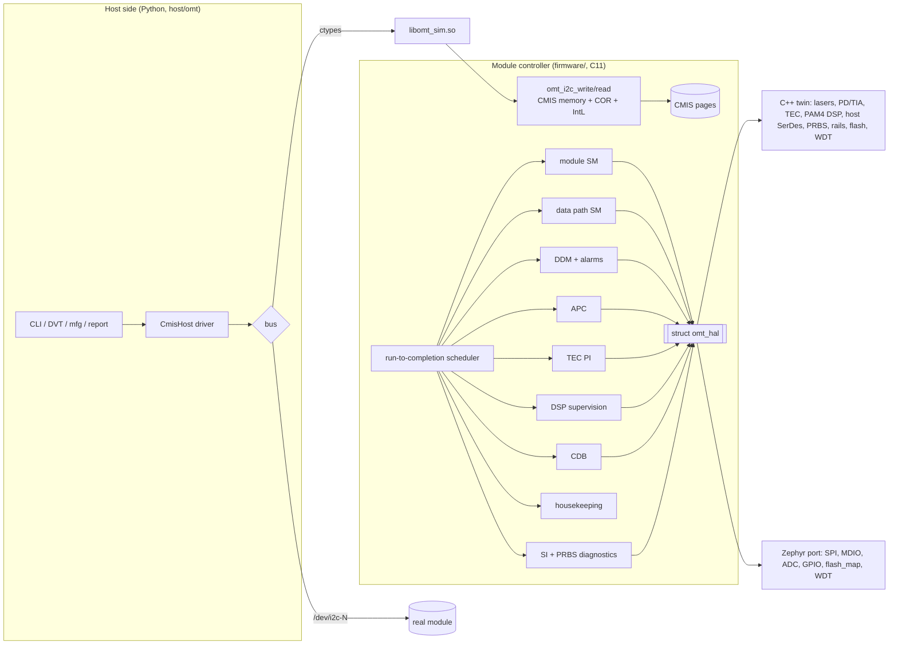

# Architecture

## Layers

## Task table (period, job)

| Task | ms | Job |
|---|---|---|
| cdb | 1 | Execute CDB commands, post CdbStatus1 + completion flag |
| apc | 5 | Laser driver status, bias/MPD readback, integral power control, EOL and eye-safety shutdown |
| msm | 10 | LowPwr requests, power-up sequence, software reset |
| dpsm | 10 | ApplyDPInit validation, per data path state machines, lane squelch |
| tec | 10 | PI loop with conditional integration, saturation supervision |
| mon | 20 | ADC sampling, calibration, CMIS encoding under irq_lock, alarms, protection |
| dsp | 100 | Heartbeat, media and host lane lock, SNR, 1 s BER/FEC windows, hang recovery |
| diag | 20 | Page 13h PRBS/loopback setup, checker lock and 1 s count windows, Page 14h results |
| house | 50 | Coalesced user-EEPROM writes, calibration commands, boot confirmation, deferred reset |
| console | 10 | UART line commands |

The firmware state is one `struct omt_fw`, so a reset is `omt_fw_init()` and
40 units run side by side in one Python process for manufacturing statistics.

## Concurrency model

On hardware the CMIS host interface runs in the I2C target ISR
(`ports/zephyr/src/main.c`). The ISR path only touches the memory image and
sets `dirty` bits; all side effects (state changes, CDB, flash writes) happen
in tasks. Tasks update multi-byte monitor values inside `hal->irq_lock()`, so
the host never reads half of a 16-bit value (REQ-MGMT-005).

## NVM layout (64 KiB, 4 KiB sectors)

| Offset | Content | Write pattern |
|---|---|---|
| 0x0000 | factory calibration + identity, CRC32 | erase + program, read-back verify |
| 0x1000 / 0x5000 | user EEPROM (page 03h), two-sector log, CRC32 per record | coalesced 500 ms after the last host write, one record per save, sector erase every 29 saves (F-010) |
| 0x2000-0x3FFF | fault log, 16-byte CRC8 records, two sectors ping-pong | append-only |
| 0x4000 | boot record (committed bank, trial, attempts, reset count) | log-structured, 170 slots per erase |
| 0x8000 / 0xC000 | firmware image banks A / B | CDB download |
